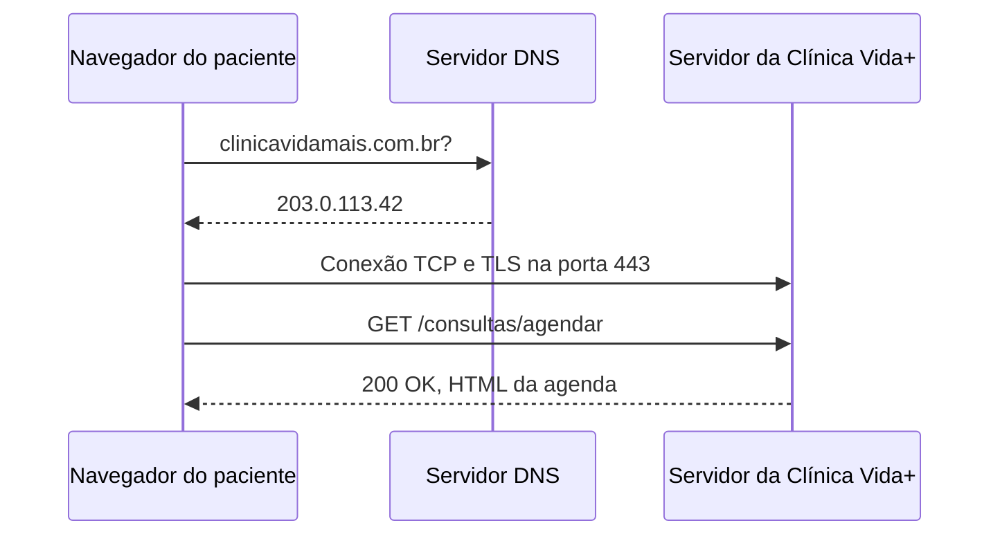

# Arquitetura da requisição web

## O caminho de uma requisição



## Evidência do DNS

Domínio investigado: github.com

Comando executado: `nslookup github.com`

```text
Server:         127.0.0.53
Address:        127.0.0.53#53

Non-authoritative answer:
Name:   github.com
Address: 140.82.114.3
```

O DNS consultado foi o servidor local `127.0.0.53`, que resolveu o domínio github.com para o endereço IP `140.82.114.3`

### Teste de conectividade

Comando executado: `ping github.com`

```text
PING github.com (140.82.114.4) 56(84) bytes of data.
^C
--- github.com ping statistics ---
3 packets transmitted, 0 received, 100% packet loss, time 2069ms
```

O comando identificou o endereço IP `140.82.114.4`, mas não recebeu respostas dos pacotes enviados. O teste foi interrompido manualmente.

## Evidência do HTTP

Foram observadas as seguintes requisições na aba Network do navegador, durante o acesso ao GitHub:

| Recurso solicitado | Método | Status |
|---|---|---|
| 69583-d3a247f92587eb2a.js | GET | 200 |
| universe26-logo-dark.svg | GET | 200 |
| dark-37b5e41810563d82.css | GET | 200 |
| avatars.githubusercontent.com/u/202680154?v=4&size=64 | GET | 304 |

### Teste HTTPS

## Por que o HTTPS é necessário?

O formulário de agendamento da Clínica Vida+ precisa utilizar HTTPS porque transmite informações pessoais dos pacientes, como CPF, telefone e data de nascimento. O HTTPS utiliza criptografia TLS para proteger essas informações durante a comunicação entre o navegador e o servidor. Dessa forma, impede que terceiros consigam ler ou alterar facilmente os dados durante a transmissão. Também permite verificar a identidade do servidor por meio de seu certificado digital.